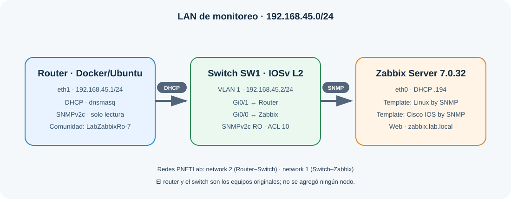
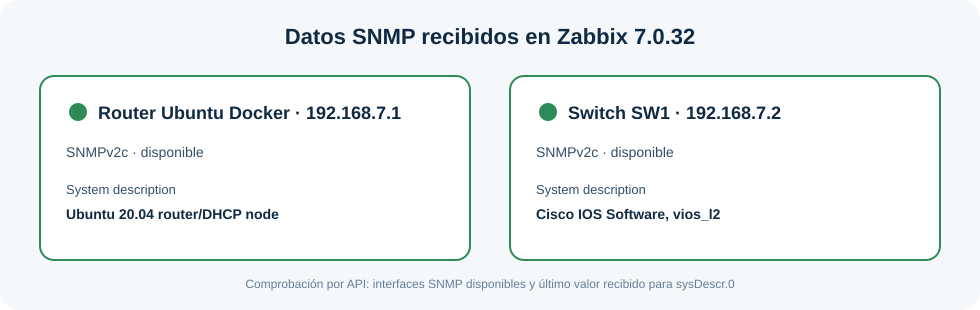

## Video demostrativo

**Enlace de YouTube:** pendiente de grabar y publicar por el estudiante. El video debe durar como máximo 10 minutos e incluir fecha y hora, rostro y voz del estudiante.

# Laboratorio de seguridad de redes: DHCP y monitoreo SNMP

## Propósito

Demostrar una LAN administrada por un router Ubuntu existente en el nodo Docker de PNETLab. El router entrega direccionamiento por DHCP y ofrece SNMPv2c de solo lectura. Zabbix recibe dirección por DHCP y consulta por SNMP el router y el switch Cisco.

La red `192.168.45.0/24` se deriva de los dos últimos dígitos de la matrícula (`45`).

## Topología



El laboratorio conserva los tres nodos de la topología: Docker/Ubuntu como router, Switch Cisco IOSv L2 y Zabbix Server. No requiere un nodo FortiGate.

| Equipo | Interfaz en el laboratorio | Dirección | Función |
|---|---|---:|---|
| Router Ubuntu (Docker) | `eth1` | `192.168.45.1/24` | Gateway de LAN, DHCP y SNMP de solo lectura |
| Switch SW1 | VLAN 1 | `192.168.45.2/24` | Conmutación L2 y administración SNMP |
| Zabbix Server 7.0.32 | `eth0` | `192.168.45.194/24` por DHCP | Monitoreo SNMP de router y switch |
| Pool DHCP | LAN | `192.168.45.100–192.168.45.199` | Reservación de Zabbix: `192.168.45.194` |



## Configuración y verificación

- El router Ubuntu tiene `192.168.45.1/24` y ejecuta `dnsmasq` para DHCP. La puerta de enlace entregada es `192.168.45.1`; Zabbix tiene una reservación DHCP para mantener su dirección en `.194`.
- El switch tiene la SVI `Vlan1` en `192.168.45.2/24`, gateway `192.168.45.1` y sus puertos de laboratorio en VLAN 1.
- Router y switch utilizan SNMPv2c con comunidad de solo lectura `LabZabbixRo-7`. El agente Ubuntu limita consultas a `192.168.45.0/24`; Cisco limita la comunidad con ACL 10.
- Zabbix contiene `Router Ubuntu Docker` con la plantilla `Linux by SNMP` y `Switch SW1` con `Cisco IOS by SNMP`.
- La API de Zabbix mostró disponibilidad SNMP en ambos hosts y datos `System description`: `Ubuntu 20.04 router/DHCP node` y `Cisco IOS Software, vios_l2 Software`.
- Zabbix Web está en `http://zabbix.lab.local/` o `http://192.168.45.194/`. Credenciales iniciales del appliance: `Admin` / `zabbix`.

## Archivos del laboratorio

- [`lab/Tarea-Semana-7.unl`](lab/Tarea-Semana-7.unl): topología PNETLab con los tres nodos existentes.
- [`running-configs/SW1-running-config.txt`](running-configs/SW1-running-config.txt): running-config exportado del switch.
- [`running-configs/Router-DHCP.conf`](running-configs/Router-DHCP.conf): configuración efectiva de dnsmasq.
- [`running-configs/Router-SNMP.conf`](running-configs/Router-SNMP.conf): configuración efectiva del agente SNMP del router.
- [`scripts/router-start.sh`](scripts/router-start.sh): configura y levanta DHCP y SNMP en el nodo Docker.
- [`scripts/config_docker_router.py`](scripts/config_docker_router.py): hook de inicio de PNETLab para el Docker router.
- [`scripts/configure_zabbix_hosts.py`](scripts/configure_zabbix_hosts.py): crea o actualiza los hosts del router y el switch mediante la API de Zabbix.

## Arranque

1. En PNETLab, iniciar el laboratorio `Tarea Semana 7 (Asignación 3)`.
2. El nodo Docker ejecuta el hook `config_docker_router.py`; `eth1` queda en `192.168.45.1/24` y se levantan DHCP y SNMP.
3. El appliance Zabbix recibe una dirección por DHCP. La reservación configurada para su MAC es `192.168.45.194`.
4. Zabbix consulta los dos dispositivos por SNMP. Si se necesita recrear los hosts, ejecutar desde una máquina que alcance Zabbix:

   ```sh
   python3 scripts/configure_zabbix_hosts.py \\
     --url http://zabbix.lab.local/api_jsonrpc.php \\
     --password 'CONTRASENA_ADMIN_ZABBIX'
   ```

## Demostración sugerida

Mostrar la fecha y hora; la topología con los tres nodos; la IP del router y del switch; el lease DHCP de Zabbix; y en Zabbix, ambos hosts con disponibilidad SNMP y el valor `System description`. El video final debe subirse a YouTube y su enlace agregarse al inicio de este README y a `Starlincampusano_20221745_A3.txt`.
